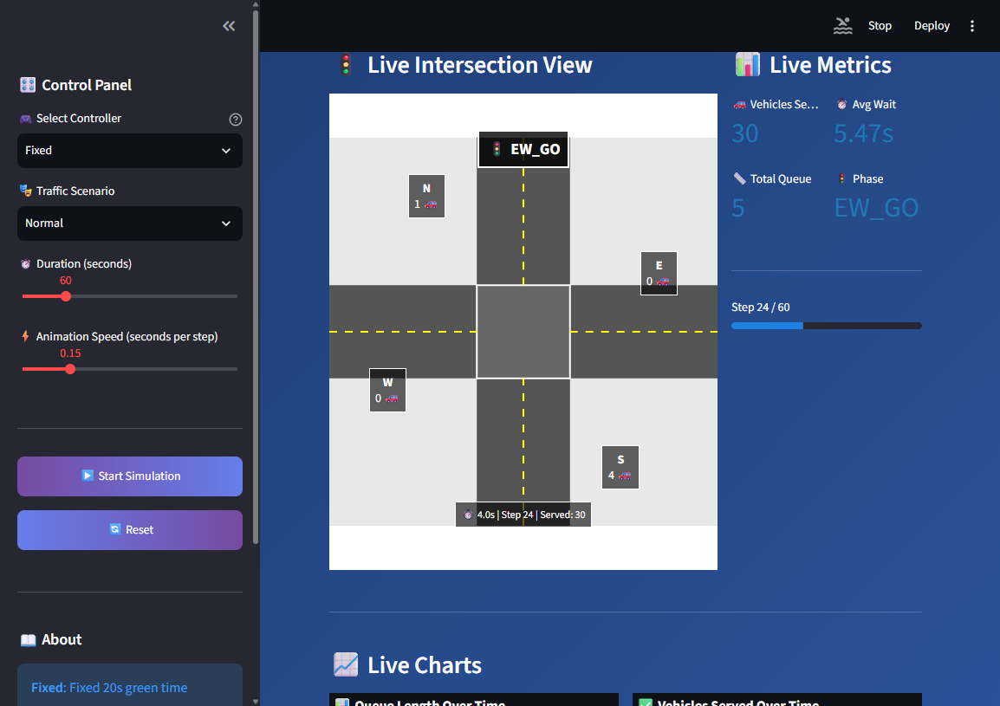

# AI-BASED ADAPTIVE TRAFFIC SIGNAL OPTIMIZATION USING REAL-TIME VEHICLE DENSITY

A traffic-intersection simulator for exploring fixed-time, rule-based, and deep-learning signal controllers under changing vehicle demand. The live dashboard visualizes the simulated intersection, signal phase, vehicle queues, throughput, and waiting time.

> This is a software simulation. It does not connect to traffic cameras, roadside sensors, or physical traffic signals.

## Dashboard



## Features

- Compare fixed-time, queue-aware rule-based, and TensorFlow deep-learning controllers.
- Explore eight traffic patterns, including rush-hour, directional-heavy, low-traffic, and sudden-spike scenarios.
- Run and observe an animated intersection simulation with live queue and performance metrics.
- Train the included 13-feature, three-action deep-learning model from the generated dataset.
- Run multi-seed controller experiments with a shared traffic schedule for fair comparisons.

## Quick Start

Use Python 3.10 or later. From the project directory, create and activate a virtual environment, then install the dependencies:

```powershell
py -3.10 -m venv .venv
.venv\Scripts\Activate.ps1
python -m pip install --upgrade pip
python -m pip install -r requirements.txt
```

Start the live dashboard:

```powershell
streamlit run live_dashboard.py
```

Streamlit prints a local URL, usually `http://localhost:8501`.

## Training and Experiments

The repository includes a trained Keras model and scaler in `model/`, so the dashboard can run without retraining. To retrain from `dataset/traffic_dataset.csv`:

```powershell
python train_quick.py
```

To compare controllers across the configured scenarios and random seeds:

```powershell
python run_experiment.py
```

Experiment tables and plots are written to `results/`.

## Tests

```powershell
python -m pytest -q
```

## Project Layout

```text
traffic_ai/
|-- config/                 # Simulation and model configuration
|-- dataset/                # Synthetic training data
|-- model/                  # Trained Keras model and feature scaler
|-- results/                # Example experiment outputs and plots
|-- screenshots/            # Dashboard screenshot
|-- src/
|   |-- controllers/        # Fixed, rule-based, and deep-learning controllers
|   |-- dataset/            # Synthetic data generation
|   |-- evaluation/         # Experiment metrics and visualizations
|   |-- model/              # Model training and evaluation code
|   `-- simulation/         # Vehicles, roads, intersection, and traffic generation
|-- tests/                  # Pytest suite
|-- live_dashboard.py       # Interactive live simulation
|-- run_experiment.py       # Multi-scenario controller comparison
`-- train_quick.py          # Model training entry point
```
